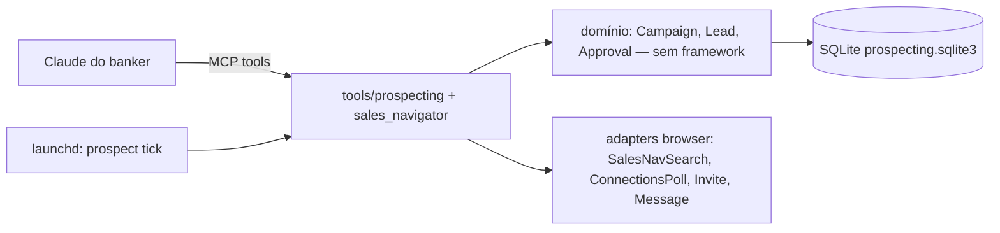

# SDD — Prospecção em lote via Sales Navigator

## 1. Contexto & Problema

- O banker de prospecção (Picanço) usa o Sales Navigator todo dia, **100% manual**: monta filtros (cargo/senioridade alta, setor, região, porte), adiciona pessoas uma a uma, acompanha aceites e manda a primeira mensagem uma a uma. Não parte de lista nem de URL.
- Dor 1 — **latência do aceite**: não existe aviso confiável de "aceitou"; o banker descobre tarde e a abordagem esfria.
- Dor 2 — **trabalho repetitivo**: um lote típico de ~50 convites exige ~50 cliques de convite + ~50 mensagens individuais.
- Estado técnico (branch `feat/sales-navigator`, checkpoint `08bb840`): existem `sales_nav_status/search_leads/search_accounts/list_leads`, só leitura, exigindo **URL colada**; links `/sales/lead/` e `/sales/company/` não são classificados (resultado útil vazio); testes com fixture sintético `/in/` não protegem o comportamento; sem paginação, export, convite, aceite ou campanha. Já existe `ProspectingLimits` (SQLite, teto diário invite=20/message=40, dry-run).
- **Lacuna de números:** tempo/dia gasto pelo banker, taxa de aceite e tempo médio até a 1ª mensagem não foram medidos. Ver Pontos em Aberto.

## 2. Comportamento Esperado

O consumidor é o **Claude do banker** (via MCP/CLI); a estratégia (quem abordar, texto) fica nele, o CLI executa com segurança.

1. **Busca por filtros** → o Claude passa filtros estruturados (cargos, senioridade, setor, região, porte, sinais como "mudou de cargo em 90d"); o CLI monta a busca do Sales Navigator, pagina até o limite pedido e devolve leads estruturados.
2. **Triagem/dedup** → cada lead vem marcado: já conexão, convite pendente, já abordado em campanha anterior, novo.
3. **Campanha** → o banker cria uma campanha com os leads escolhidos; o CLI devolve o **lote de convites para aprovação em lote** (com nota opcional por lead).
4. **Convites** → após aprovação, envio espaçado (intervalo fixo, sem evasão), dentro dos tetos diário e semanal; o CLI informa a cota restante.
5. **Detecção de aceite** → job periódico em horário comercial lê em lote a lista de conexões recentes e cruza com convites da campanha; aceitos mudam de estado com timestamp.
6. **Fila de mensagens** → para cada aceito, o Claude gera rascunho; o banker **aprova em lote** (vendo cada texto); envio espaçado, dentro dos tetos.
7. **Respostas** → leitura de previews (sem marcar como lida) detecta resposta e move o lead para `respondeu`.
8. **Export** → CSV/JSON da campanha com estado de cada lead.
9. **Retomada** → qualquer queda (sessão, rede, rate limit) retoma do estado persistido sem reenviar nada.

## 3. Restrições & Premissas

- **Restrição:** nenhum envio (convite/mensagem) sem aprovação explícita do banker; aprovação é **em lote**, com cada item visível.
- **Restrição:** tetos conservadores ligados por padrão (convites ~20/dia e ≤100/semana; mensagens 40/dia), intervalo entre ações, só horário comercial. Banker será avisado dos limites.
- **Restrição:** roda local na máquina do banker com a sessão dele (`~/.linkedin-mcp`); nenhum dado de lead sai para serviço externo não homologado; nada de token/cookie/.env no repo; secret scan antes de push.
- **Restrição:** só UI/DOM e dados que a própria página já buscou; sem chamar APIs privadas (Voyager/Sales API) diretamente, sem interceptar requests de escrita (decisão do repo de 2026-09-16).
- **Restrição:** testes de envio só em dry-run; e2e com envio real somente com ok do Victor item a item.
- **Premissa:** a conta do banker tem Sales Navigator ativo; o Victor não tem — observar o primeiro uso real depende do fluxo normal do banker, mas não há sessão dedicada de mapeamento de filtros.
- **Premissa:** Python (stack do upstream), patchright 1.64.3 fixo.

## 4. Fora do Escopo

- InMail, criação/edição de listas salvas no Sales Navigator, sequências multi-mensagem automáticas (follow-up 2, 3…).
- Envio sem aprovação humana.
- Integração com CRM (Salesforce/BTG) — fase futura, depende de homologação.
- Estratégia/ICP e redação dos textos (responsabilidade do Claude do banker + compliance).
- Daemon multi-cliente (permanece experimental no upstream).

## 5. Decisões Técnicas

| Decisão | Escolha | Racional |
|---|---|---|
| Entrada da busca | Filtros estruturados → URL do Sales Navigator montada pelo CLI (URL colada continua aceita) | Banker parte de filtros; URL colada não serve ao fluxo real. |
| IDs de filtro | Resolver rótulos em tempo de uso na typeahead renderizada do Sales Navigator; cache local SQLite por tipo/rótulo normalizado/locale, TTL de 30 dias; o JSON é apenas seed opcional | O banker descreve o ICP em texto livre. IDs vêm das sugestões visíveis; ambiguidade volta como candidatos e nunca é adivinhada. A busca confere IDs no URL final e invalida cache se algum filtro sumir. |
| Estado | Estender o SQLite de `ProspectingLimits` (tabelas novas), com root fixo ao lado da sessão e conferido no start | Fonte única de tetos e idempotência; root divergente entre MCP e `launchd` reenviaria lotes. |
| Detecção de aceite | Hipótese: polling da lista de conexões recentes (a medir na fase 1). Fallback: releitura dos `invited` com teto de páginas por tick | Sem webhook; lista é da conta inteira e pode não ter ordenação/vanity estrutural — decidir com captura real. |
| Envio | Chave **única global** `(lead_vanity, kind)` com estado `*_unconfirmed` gravado antes do clique; reconciliação por releitura (`detect_connection_state`) antes de qualquer retry | `reserve` atual só conta cota; sem estado ambíguo a retomada reenvia. |
| Aprovação | Token de aprovação por lote (lista explícita de IDs + hash dos textos); envio exige o token | Lote, mas texto alterado após aprovar invalida o envio. |
| Leitura de respostas | Preview sem clique (frente A) | Não marcar conversas do banker como lidas. |
| Agendamento | Comando `prospect tick` idempotente, chamado por launchd (macOS) | Simples, retomável, sem processo eterno; cada tick faz o que estiver pendente. |
| Alternativa descartada | API oficial Sales Navigator (SNAP) | Exige parceria LinkedIn; inviável agora. |

**Custo estimado:** R$ 0 de infra (local). Custo de IA fica no Claude do banker.

## 6. Arquitetura & Contratos

**Princípio central:** o Claude decide, o CLI executa com estado persistido, tetos e aprovação — nenhuma ação de escrita existe sem reserva no SQLite e token de aprovação.



Camadas: domínio puro (`prospecting/domain.py`: estados e transições), repositório SQLite, adapters de browser (DOM), tools MCP finas.

**Contratos centrais:**

A busca estruturada é `sales_nav_search_leads_by_filters`, somente leitura, com construção Rest.li e reuso do `SalesNavigatorReader`. `sales_nav_resolve_filters` aceita rótulos livres organizados por tipo, visita uma vez a busca de pessoas para o lote e lê as sugestões renderizadas; usa IDs dos atributos DOM quando disponíveis e, caso contrário, seleciona uma sugestão exata e lê ID e texto da URL Rest.li resultante. Não inspeciona corpos de respostas da página. O cache fica no mesmo `prospecting.sqlite3` do estado de prospecção e distingue o locale da conta. Cada visita de resolução reserva uma navegação `sales_nav`. Um match exato único com ID pode ser usado; múltiplos candidatos retornam `needs_clarification` para o Claude perguntar ao banker; sem ID verificável, o status é `unresolved` e não há busca. A URL final é conferida também nos filtros aninhados em `query`, inclusive keywords, não apenas pela presença do parâmetro externo. Se um ID solicitado não sobreviver à navegação, a entrada correspondente é removida do cache.

```json
// sales_nav_search_leads (entrada)
{"filters": {"titles": ["CFO", "Diretor Financeiro"], "seniority": ["CXO", "Director"],
  "industries": ["Manufacturing"], "geographies": ["São Paulo, Brasil"],
  "company_headcount": ["501-1000", "1001-5000"], "changed_jobs_90d": true},
 "max_results": 50}

// saída (por lead)
{"lead_urn": "urn:li:fs_salesProfile:(ACwAA...,NAME_SEARCH,abc)", "profile_url": "https://www.linkedin.com/in/fulano/",
 "name": "Fulano de Tal", "title": "CFO", "company": "Indústria X", "location": "São Paulo",
 "connection_degree": 2, "dedup_status": "new"}
```

```json
// approve_batch
{"campaign_id": "cmp_20261103_cfo_sp", "kind": "invite",
 "items": [{"lead_urn": "...", "note": null}],
 "approval_token": "apv_9f2c…", "items_hash": "sha256:…"}
```

Estados do lead: `imported → invite_approved → invited → accepted → message_drafted → message_approved → messaged → replied` (+ `skipped`, `invite_failed`, `withdrawn`).

**Modelo de dados (SQLite):** `campaigns(id, name, filters_json, created_at)`, `leads(campaign_id, lead_urn, profile_url, name, title, company, state, updated_at)`, `approvals(token, campaign_id, kind, items_hash, approved_at, consumed_at)`, `events(id, campaign_id, lead_urn, kind, payload_json, at)` (auditoria append-only), reaproveitando `writes` para tetos. Ciclo de vida: local do banker; export sob demanda; retenção a definir (LGPD).

**Integrações:** LinkedIn/Sales Navigator via browser (sessão do banker) — sem API.

## 7. Plano de Entrega

> Revisado após revisão adversarial (Grok 4.7, 2026-11-03): proteções de conta e estado ambíguo passam a vir ANTES do primeiro envio real; busca por filtros e polling de aceite viram hipóteses a medir.

| Fase | Objetivo | Validação observável | Estimativa |
|---|---|---|---|
| 0 — Correções base (frente A, paralela, não bloqueia) | Lookup de conversa independente de idioma, leitura sem marcar lida, guarda de versão do browser | Testes falham sem o fix; inbox lida sem alterar não-lidas | 1 dia |
| 1 — Primeiro uso observado | Durante o uso normal, observar (anonimizado) rótulos e sugestões da busca, retenção dos filtros na URL, links de lead e a lista de conexões recentes | Primeiro uso observado e diferenças registradas; sem sessão dedicada de mapeamento nem catálogo manual; decisão sobre polling de aceite | Durante o uso normal |
| 2 — Busca real | Classificar `/sales/lead|company/`, leads estruturados com vanity `/in/`, status com paywall, paginação; filtros resolvidos pela typeahead e validados na URL final | Busca na conta do banker → leads e filtros batendo com a tela; teste falha se o classificador sumir | 2–3 dias |
| 3 — Campanha + proteções | Domínio, SQLite no mesmo root da sessão, chave única `(lead_vanity)` global, estados ambíguos, disjuntor de conta, teto semanal, lease exclusivo, aprovação por item | Dry-run de 50 sem browser de escrita; **1 convite real com kill no meio → retomada não reenvia** | 3 dias |
| 4 — Convites em lote | Envio em lote via fila retomável (fora do timeout de 180 s da tool), export, auditoria | 3 convites reais aprovados pelo Victor; tetos respeitados | 1–2 dias |
| 5 — Aceite | Polling da lista de conexões se a medição da fase 1 provar viável; senão releitura dos `invited` com teto de páginas por tick | Aceite detectado ≤30 min sem falso positivo | 2 dias |
| 6 — Mensagens + respostas | Fila de rascunhos com hash conferido pelo servidor, `confirm_send` por item, detecção de resposta sem clique | Kill no meio do lote de mensagens → sem duplicar | 3 dias |
| 7 — Onboarding | Docs e skill do Claude do banker, baseline medido antes do primeiro envio | Banker roda campanha real de 1 semana | 1–2 dias |

**Premissas da estimativa:** 1 braço de IA (Grok 4.7) codando, Claude revisando; sessão com o banker na fase 1.

**Requisitos incorporados da revisão (obrigatórios):**
- Estados novos: `invite_unconfirmed`/`message_unconfirmed` (retomada **nunca** reenvia; reconcilia relendo o perfil), `already_connected`, `already_pending`, `incoming_request` (terminal: campanha **nunca** aceita convite recebido — `connect_with_person` hoje aceita), `connect_unavailable`/`follow_only`, `reply_unconfirmed`.
- Pausa de **campanha** (não do lead) em 429/999, checkpoint/CAPTCHA, limite semanal ou cota de nota: para tudo por 24 h e avisa.
- Aprovação: servidor emite o token e recalcula o hash; consumo **por item**, não por lote.
- Tick do `launchd` só roda sem sessão interativa ativa (lease); nunca dois Chromiums no perfil.
- Teto semanal e `outcome_unknown`/`send_failed` contam na cota; não reseta sobre convite não confirmado.
- Visitas a perfil notificam o lead: contabilizadas como ação no orçamento diário.

## 8. Riscos

| Risco | Mitigação | Dono |
|---|---|---|
| Restrição/ban da conta do banker (Help Center trata automação como motivo de restrição; risco não zera com tetos) | Tetos diário+semanal, orçamento de navegações (visitas contam), disjuntor 24 h, tick só sem sessão interativa; banker ciente e de acordo | Victor |
| DOM do Sales Navigator muda | Resolver por estrutura genérica, fixture sintético identificado até existir captura anonimizada, erro explícito e cache com TTL | Dev |
| Sem licença para testar | Sessões assistidas com o banker; fixtures capturadas e anonimizadas | Victor |
| Compliance da 1ª abordagem | Templates aprovados por compliance; auditoria de todo envio | Victor / Compliance |
| Dados pessoais de leads (LGPD) | Local, sem envio externo, retenção definida, export controlado | Victor |

## 9. Pontos em Aberto

1. **Decisão necessária:** quem aprova os templates de 1ª mensagem (compliance)? — dono Victor, antes da fase 3.
2. **Decisão necessária:** tetos finais (convites/dia e semana) — proposta 20/dia, 100/semana. — dono Victor + banker.
3. **Decisão necessária:** retenção dos dados de lead no SQLite (LGPD). — dono Victor.
4. Medir baseline com o banker: tempo/dia, convites/semana, taxa de aceite, tempo até 1ª mensagem. — dono Victor, antes da fase 4.
5. Observar o primeiro uso normal do Sales Navigator com o banker (fase 1), sem exigir uma sessão separada para mapear IDs.
